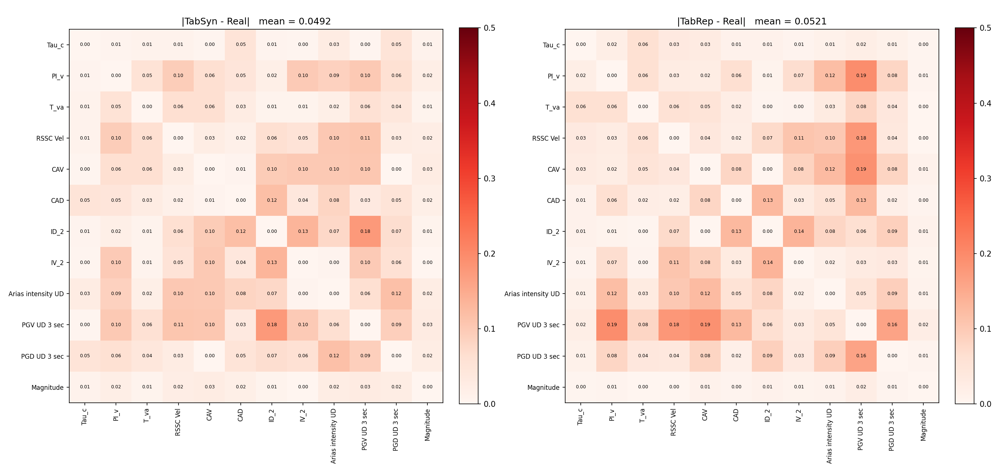
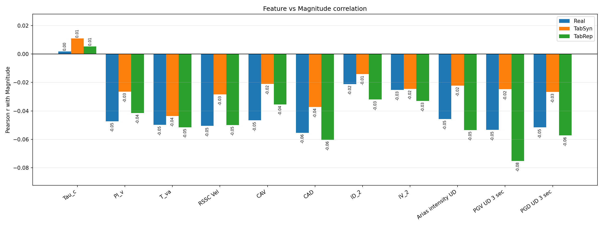

# diffusion-models-earthquake-tabular-data
Synthetic tabular data generation for Earthquake Early Warning (EEW) P-wave ground-motion parameters and Magnitude prediction using TabSyn and TabRep deep generative models. Includes training pipelines, pretrained checkpoints, synthetic datasets, and correlation fidelity benchmarks.

# 🌍 Synthetic Earthquake Early Warning (EEW) Dataset Generation with TabSyn & TabRep

[](https://www.python.org/downloads/)
[](https://pytorch.org/)
[](LICENSE)
[](#model-architectures)

A deep generative modeling pipeline for synthesizing **tabular Earthquake Early Warning (EEW) P-wave ground-motion datasets** using two state-of-the-art tabular generative frameworks: **TabSyn** (Latent Score-Based Diffusion) and **TabRep** (Continuous Flow-Based Representation Learning).

---

## 📌 Overview & Motivation

In **Earthquake Early Warning (EEW)** systems, rapid magnitude estimation relies on parameters extracted from the first 3 seconds of the initial P-wave arrival. However, historical seismic records contain very few large-magnitude ($M \ge 6.0$) destructive events, creating severe data scarcity when training machine learning models for rapid hazard alerts.

This project solves that bottleneck by:
1. **Training** **TabSyn** and **TabRep** on 11 physical P-wave ground-motion features alongside target earthquake `Magnitude`.
2. **Generating** **10,000+ synthetic seismic records** per model that preserve complex non-linear inter-feature correlations (e.g., between peak ground velocity, cumulative absolute velocity, Arias intensity, and magnitude).
3. **Benchmarking** both models via Pearson correlation matrices, Mean Absolute Difference (MAD) heatmaps, and feature-to-magnitude alignment.

---

## 📊 Earthquake Early Warning (EEW) Feature Schema

The models synthesize **12 continuous seismic parameters** (11 input P-wave attributes + 1 target magnitude):

| Feature | Unit / Type | Physical Description |
| :--- | :--- | :--- |
| `Tau_c` | Seconds ($\text{s}$) | Characteristic period of the initial P-wave ground motion |
| `PI_v` | $\text{cm}/\text{s}$ | Predominant period / peak velocity parameter |
| `T_va` | Seconds ($\text{s}$) | Ratio of velocity to acceleration period parameter |
| `RSSC Vel` | $\text{cm}/\text{s}$ | Root Sum of Squares Cumulative Velocity |
| `CAV` | $\text{cm}/\text{s}$ | Cumulative Absolute Velocity |
| `CAD` | $\text{cm}$ | Cumulative Absolute Displacement |
| `ID_2` | $\text{cm}^2\cdot\text{s}$ | Integral of squared displacement |
| `IV_2` | $\text{cm}^2/\text{s}$ | Integral of squared velocity |
| `Arias intensity UD` | $\text{m}/\text{s}$ | Up-Down (vertical) Arias Intensity measuring total seismic energy |
| `PGV UD 3 sec` | $\text{cm}/\text{s}$ | Peak Ground Velocity (vertical) within the first 3 seconds of P-wave |
| `PGD UD 3 sec` | $\text{cm}$ | Peak Ground Displacement (vertical) within the first 3 seconds of P-wave |
| **`Magnitude`** | **Target ($M$)** | **Earthquake magnitude** |

> 💡 **Sample Preview:** 1,000-row sample CSVs generated by both models are included directly in [`data/synthetic/`](data/synthetic/).

---

## 🧠 Model Architectures & Hyperparameters

| Model | Generative Approach | Training Configuration |
| :--- | :--- | :--- |
| **TabSyn** | Variational Autoencoder (VAE) + Latent Score-Based Diffusion | `VAE Epochs: 500`, `Diffusion Epochs: 1500`, `Samples: 10,000` |
| **TabRep** | Continuous Representation Learning + Flow Matching (`tabrep_flow`) | `Steps: 5000`, `Batch Size: 256`, `Samples: 10,000` |

---

## 📈 Visual Evaluation (Real vs. TabSyn vs. TabRep)

### 1. Pairwise Pearson Correlation Matrices
Side-by-side comparison of inter-feature correlation structures across the **Real** dataset, **TabSyn**, and **TabRep**:


### 2. Absolute Correlation Difference ($|\text{Synthetic} - \text{Real}|$)
Heatmap of absolute pairwise correlation errors (values closer to `0.00` indicate stronger structural preservation):



### 3. Feature vs. Magnitude Correlation Alignment
Comparison of how accurately each generative model reproduces the physical correlation between every P-wave parameter and target `Magnitude`:



---

## 🏆 Quantitative Correlation Fidelity

| Model | Mean Absolute Correlation Difference (MAD $\downarrow$) | Max Single-Pair Gap ($\downarrow$) | Generated Samples |
| :--- | :---: | :---: | :---: |
| **Real (Baseline)** | `0.0000` | `0.0000` | `[Real Row Count]` |
| **TabSyn** | `[Insert MAD from p2_difference.png]` | `[Insert Max Gap]` | `10,000` |
| **TabRep** | `[Insert MAD from p2_difference.png]` | `[Insert Max Gap]` | `10,000` |

---

## 🚀 Quickstart

### 1. Clone & Install Dependencies
```bash
git clone https://github.com/Yatn-max/diffusion-models-earthquake-tabular-data.git
cd diffusion-models-earthquake-tabular-data
python -m venv venv
source venv/bin/activate  # On Windows: venv\Scripts\activate
pip install -r requirements.txt
```

### 2. Download Full Synthetic Datasets & Model Checkpoints
Full 10,000-row synthetic datasets and pretrained `.pt` model checkpoints are available in **[GitHub Releases]([https://github.com/Yatn-max/diffusion-models-earthquake-tabular-data/releases](https://github.com/Yatn-max/diffusion-models-earthquake-tabular-data/releases))**:
* `tabsyn_synthetic_10k.csv` & `tabsyn_ckpt.pt`
* `tabrep_synthetic_10k.csv` & `tabrep_ckpt.pt`

### 3. Train & Generate Synthetic Data
```bash
# Run TabSyn pipeline
python scripts/run_tabsyn.py \
  --input data/raw/real_earthquakes.csv \
  --output data/synthetic/tabsyn_synthetic.csv \
  --n_syn 10000

# Run TabRep pipeline
python scripts/run_tabrep.py \
  --input data/raw/real_earthquakes.csv \
  --output data/synthetic/tabrep_synthetic.csv \
  --n_syn 10000
```

### 4. Run Evaluation & Generate Plots
```bash
python scripts/evaluate.py \
  --real data/raw/real_earthquakes.csv \
  --tabsyn data/synthetic/tabsyn_synthetic.csv \
  --tabrep data/synthetic/tabrep_synthetic.csv \
  --assets_dir assets
```

---

## 📁 Repository Structure

```text
├── assets/
│   ├── p1_correlations.png       # Real vs TabSyn vs TabRep correlation matrices
│   ├── p2_difference.png         # Absolute difference heatmaps vs Real
│   └── p3_magnitude_corr.png     # Feature-to-Magnitude Pearson r comparison
├── data/
│   └── synthetic/
│       ├── tabsyn_sample_1k.csv  # 1,000-row preview from TabSyn
│       └── tabrep_sample_1k.csv  # 1,000-row preview from TabRep
├── notebooks/
│   └── high_data_generation.ipynb # Original Google Colab workflow
├── scripts/
│   ├── utils.py                  # Data preprocessing & repo patching utilities
│   ├── run_tabsyn.py             # TabSyn training & sampling CLI
│   ├── run_tabrep.py             # TabRep training & sampling CLI
│   └── evaluate.py               # Correlation fidelity evaluation & plotting
├── requirements.txt
└── README.md
```

---

## 📚 References

* **TabSyn:** Zhang et al., *"Mixed-Type Tabular Data Synthesis with Score-based Diffusion in Latent Space"*, ICLR 2024. ([amazon-science/tabsyn](https://github.com/amazon-science/tabsyn))
* **TabRep:** Si et al., *"TabRep: Continuous Representation Learning for Mixed-Type Tabular Data Generation"*. ([jacobyhsi/TabRep](https://github.com/jacobyhsi/TabRep))

---

## 📄 License

This project is licensed under the MIT License — see the [LICENSE](LICENSE) file for details.
